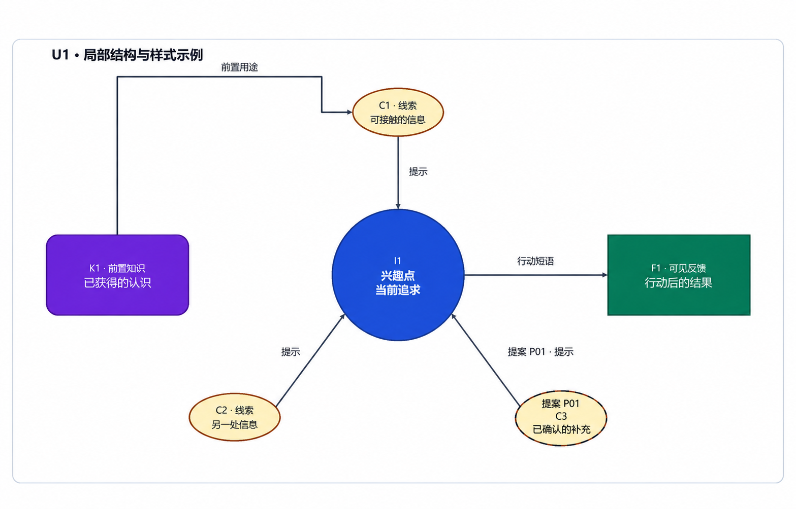

# 画板样式与排版卡

版本：draft-0.3 · 2026-11-11。用于初绘和最终排版，配合局部卡与网络卡；手画和AI绘制使用相同规则。以下是本工具包固定样式，不随画板随机选色；用户明确要求其他样式时记录其选择，但保留大小层级、角色标签和提案前缀。

## 1. 图面只留下什么

画板只保留：短标题/版本、知识锁编号与短名称、节点编号与短语、必要关系短标签、短条件、提案前缀，以及一份紧凑图例。完整来源、设计理由、机制长说明、提案清单、玩家经历说明、审阅问题及检查报告都放在画板之外的同一项目说明文档中，用节点或关系编号关联。

节点采用“首行编号/角色与状态＋最多两行内容短语”；每行只承载一个意思。连线使用短动词或用途，通常不超过12个汉字（提案前缀另计）；必要限定词不能因缩短而丢失。放不下的解释移到图外，只保留可定位引用。不要缩小字号、扩大线索节点或增加大段浮动文字来容纳说明。

**先确认提案，再绘制，并保留补充来源标记。**绘图前在图外提出具体提案并取得用户决定，未确认提案不进入图稿。已采纳且绘入的补充在相应位置前置`提案 P01 · C3`、`提案 N06 · 姓名提示`或`提案 P02 · 开放条件`。标记表示来源，不表示仍待决定，采纳后继续保留；确认记录在图外。节点、关系、条件、图像标题各自适用；若只有连线新增，只标该连线。保留原有稳定编号，不能仅用颜色、“建议”后缀或总声明代替前缀。提案节点可用虚线外框辅助区分来源；关系仍用文字前缀，避免与“配置依据”虚线混淆。

## 2. 固定节点样式

画布白色`#FFFFFF`；普通文字`#111827`；关系线及标签`#334155`。以下尺寸是100%设计尺度的宽×高，允许整张图同比例缩放，不能只把主节点缩小到线索大小。

| 角色 | 形状 | 基准尺寸 | 填充 | 文字 | 边框 |
| --- | --- | --- | --- | --- | --- |
| I 兴趣点 | 圆形，局部中心 | 260×260 | `#1D4ED8` | `#FFFFFF` | `#1E3A8A`，3 |
| K 知识：前置或预期形成 | 圆角矩形，核心结构外 | 280×160 | `#6D28D9` | `#FFFFFF` | `#4C1D95`，3 |
| F 可见反馈 | 直角矩形，核心结构外 | 280×160 | `#047857` | `#FFFFFF` | `#064E3B`，3 |
| C 线索 | 小椭圆，兴趣点周围 | 180×96 | `#FEF3C7` | `#111827` | `#92400E`，2 |

I、K、F是大节点；C是小节点。K不因位于上游就自动代表开局已知，使用“前置”“形成”等短标签区分当前用途。固定形状只是视觉编码，不给原关系增加新的逻辑含义。

节点正文：I/K/F用22，C用18；编号/状态18，局部标题26，关系/条件18。主内容不得比关系文字更小。I标题加粗。大节点内容区预留24内边距，小节点12；文字须落在圆/椭圆实际内部，不能只按外接矩形判断。颜色与形状、大小和角色字母同时辨认，不以红绿或颜色单独传达状态。

## 3. 三角结构与网络间距

这是角色和层级示例，不是一道实际谜题；只有有意义的连接才绘线。图片用于理解层级与标记，实际绘图的精确颜色、尺寸及字号以上表为准。仅为演示本图，假定P01已在绘图前获确认并绘入。示例的图外“已加入的新内容”为：

| 编号 | 具体提案 | 对应位置 | 状态 |
| --- | --- | --- | --- |
| P01 | 补充一条信息及其提示关系，演示提案来源前缀 | C3及C3→I1 | 教学中假定已确认且加入；不是用户实案决定 |

- 兴趣点处于局部中心；三条线索时按上、左下、右下三个方向环绕，形成三角骨架。K和F放在骨架外侧，不能占线索顶点或挤到兴趣点中间。
- 线索数量按实际材料变化：一两条仍围绕中心；多于三条沿外围扩展，不为凑三角补造信息。三角是位置关系，不自动添加三条线索之间的连线。
- 一个局部用“U编号＋短标题”及浅灰边界区分，分区背景白色，边界`#CBD5E1`；不加整块彩底。边界包住该局部实际内容；共享主节点可放在局部之间，不归成另一份副本。
- 使用10的坐标网格。同一局部不相连节点边界至少留48；带关系标签的节点间优先留120以上。局部边界内留64，标题单独留48高；不同局部的外边界至少隔160。密集连线需要更多通道时扩大间距。
- 按实际信息联系安排局部位置，将频繁联系放近，共享认识放在相关单元之间。不要机械照抄游戏阶段顺序，也不要为了排满等大格子牺牲三角结构。
- 需要更多空间时扩大画布或提供同一设计的局部视图，不把全图缩成无法阅读的海报。局部视图沿用同一编号与内容。

## 4. 布线与实际读回

局部短连接可以直连；跨局部优先沿分区间空白通道正交走线，回连沿外侧绕行。不穿过无关节点、正文或标题，不把跨单元关系省成没有依据的区域箭头。共用端口拥挤时分散到不同边或连接位置；平行线间隔至少32，入节点前最后一段至少32。标签靠近所属线段，避开折点和其他标签。

优先使用绑定到实际节点的原生连接器。若载体只支持坐标端点，移动或缩放节点时同步重算所有相关端点、折点和标签；不能只移动形状。尽量保留节点文字和连接器的可编辑性，不为排版把整图压成图片。检查时记录载体确实存在的限制。

**交付前同时检查整体和局部：**全图能看出各锁边界、主次和主要联系；逐锁视图能读清文字、提案状态及关系。检查圆/椭圆内文字、提案前缀、共享引用、节点绑定/端点、交叉线和间距。实际写入后再读回或导出预览；本地渲染不能代替远端结果。没有得到当前画板预览时，只报告已做结构检查，不宣布排版通过。

绘图前的补充与确认由[提案Skill](../skills/knowledge-gate-propose/SKILL.md)处理。说明先列“已加入的新内容”再逐锁讲解，由[说明Skill](../skills/knowledge-gate-explain/SKILL.md)完成；之后[排版Skill](../skills/knowledge-gate-layout/SKILL.md)整理视觉。图内标记要与确认记录、实际新增清单及当前设计一致。

[工具卡索引](index.md) · [局部设计卡](local-lock.md) · [网络组织卡](network.md)
