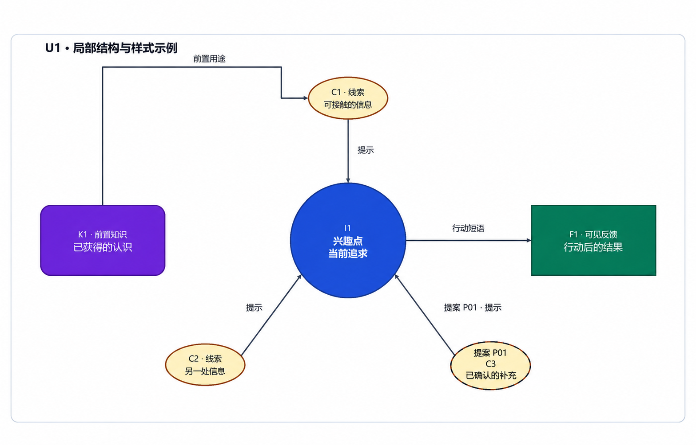
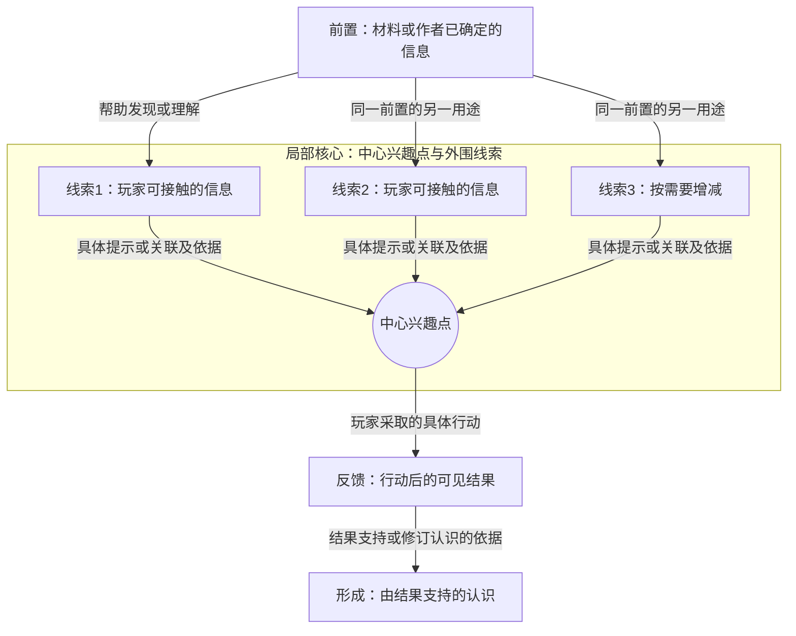
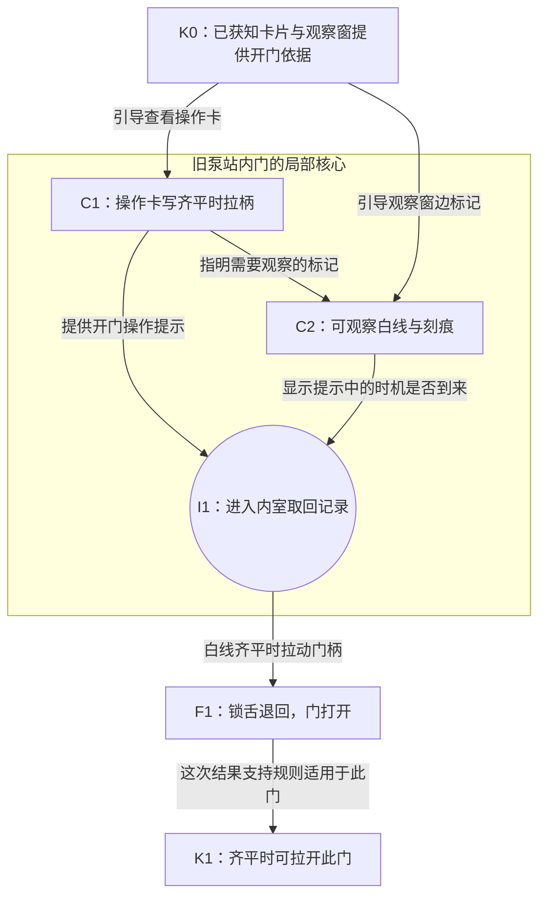

# 局部知识锁设计卡

版本：draft-0.5 · 2026-11-12。根据实践反馈补齐前置来源、关系规则与正反例，同步修订教学例；修订效果待实案验证，最终画板按固定样式绘制。

## 这张卡用来做什么

围绕一个主要兴趣点，说明玩家追求什么、能接触什么信息、怎样据此形成认识和行动，以及结果还能支持什么认识。适合从一段自然语言构想、一个已有目标、零散线索或局部图开始，也适合修改已有设计。

**输入：**当前构想或图，以及理解该局部所必需的情境、玩法和已有认识。已有目标、故事或游戏阶段材料可简短引用，不要求重新完成宏观策划。

**产出：**一份局部关系图及必要附注，标明具体内容、连接依据、实际条件和未定事项。通过相同编号或局部视图，它可直接进入[网络组织卡](network.md)。

本卡前半部分是固定说明，不需要每次抄写。实际使用时，在所选画板参照图式绘制，按需要复制“实际填写区”；将产物保存在自己的项目中。文字阅读和手画均不要求运行图表代码。

## 1. 图上分别放什么

| 位置与角色 | 写什么 | 需要避免的混用 |
| --- | --- | --- |
| 中心：大兴趣点 | 图内用短语写玩家希望接近、理解或达成什么；为何值得追查放图外说明 | “理解发生了什么”也可成为目标，不必总是开门或解锁功能 |
| 外围：小线索 | 图内放可接触信息短语；完整载体、来源、位置按需写图外 | 文章、人物、场景是载体或来源，线索是其中具体的信息 |
| 核心结构外：大知识节点 | 图内放具体认识或前置信息内容，标“前置/形成”等用途，依据放图外 | 不只写“交谈过”等事件名称，不把线索换名包装成前置；“预期形成”不表示已知 |
| 核心结构外：大反馈节点 | 玩家行动后实际可观察的结果短语 | “玩家理解了原理”不是可见结果；认识作用在图外说明，不把长解释放进节点 |
| 兴趣点通向反馈的线 | 具体行动，以及这项行动在何种情况下可做 | 验证行为属于行动，不画成该锁的一条线索 |
| 对应对象或行动旁的条件注记 | 系统功能、资源、权限、事件或时间等实际限制 | “知道门何时打开”与“门现在处于可打开状态”分别记录 |

线索与兴趣点分置，每条所属线索直接连接中心兴趣点，说明寻找信息与达成目标之间的实际联系。线索间联系按用途选画，不能代替中心直连，也不自动代表必经顺序。外围初始可放三个线索，以便组织思考；数量、位置和相互连接随实际内容调整。只有一个来源、多个来源或尚有空缺时，都保留实际情况。

### 参考图式

最终画板参照[固定样式与三角排版示例](board-style.md)：大兴趣点居中，三条小线索分别在上、左下、右下；大知识与大反馈放在核心外。实际线索数量可变，不补造顶点。新增设计先在图外提出并取得用户决定，确认后才绘入；图内保留“提案＋编号”作为补充来源标记。



图中P01只是虚构教学占位，假定已在绘图前确认并加入，配套清单见样式卡。下方Mermaid只解释角色与关系，不作为最终画板的布局或长文字范本；绘图使用上图层级及样式卡，具体内容保持原意后压缩成短语。

上方图片仅示意大小与位置，不是可照抄的完整来源图。下图示意合规的关系骨架：前置K经C到I，每条C保留来源；同一K能否复用仍以实际材料为准。它不规定玩家必须依次经过所有节点。



手画和AI绘图均按样式卡将兴趣点放中央、线索放外围角位、知识和反馈放核心外，并保留短条件。前置K不能直接推导兴趣点或连接反馈；间接线索提示可用虚线并写明用途，提案来源用文字前缀。固定样式不代替关系含义。

## 2. 连线怎样写

| 连接 | 需要说清的内容 | 图外依据示例 |
| --- | --- | --- |
| 线索→兴趣点；线索之间的联系 | 玩家凭什么把这些内容联系起来；线索之间的方向随具体提示或关联确定 | “图中的塔顶缺口对应远处可见的断墙，因此能辨认目标位置” |
| 知识→线索：前置认识用途 | 已有认识怎样帮助发现、取得或理解该线索 | “知道退潮会露出石阶，才会选择此时来观察岸边刻字” |
| 兴趣点→反馈，线上写行动 | 玩家为追查或达成目标做什么，得到什么可见结果 | “按刻痕对齐手柄后拉动→锁舌退回” |
| 反馈→知识 | 该结果为何能支持、补充或修订某项认识，以及支持到什么程度 | “这次操作与门开启同时发生，支持此设置有效；尚不能排除其他有效设置” |

关系定义以[工作流第2.2—2.3节](../workflow.md)为准：K→C→I，禁止K→I及K→F。每条C有可追溯前置或明确未知占位，并直接连接所属I。材料配置理由写图外，不作K→C来源依据；不能提前把预期答案当作前置。前置可直接告知或来自范围外，不要求再补上游知识锁。

### 前置来源核对与正反例

查策划及作者决定→复用同一K或区分不同内容→不明时询问→作者也未定则标“未知前置”。需要新设计时才走提案确认。按需在附注记录“C、K及用途、依据、已确认或未知”；不为填表造前置。

| 情况 | 正确处理 | 错误处理 |
| --- | --- | --- |
| 知道系统能查询人物位置 | K→查询得到的地点C→寻找人物I；实地找到为F | K直接连I，省略具体位置线索 |
| 同一条提示引出两处观察 | 一个已有K分别连向两条C，说明各自用途 | 为两个C各复制一个只换名称的K |
| 两处反馈分别提供半幅图形 | 两个F共同形成“可组合”的K，再引出完整图形C | 只保留一个反馈，或不说明组合认识便直达目标 |
| 只知道信息来自某类帖子 | 标明已知来源类型，具体未定处写“未知前置”并关联C | 虚构标题和引导，或未经依据断定两条线索同源/异源 |

F→C若表示权限等结果开放材料，必须标“访问条件”及具体内容，不能代替该C的K来源。多反馈形成K时标明“共同形成”，不把多条输入默认为任一条单独充分。

节点记短内容，线记短用途，例如“对应缺口”“退潮时观察”“拉动手柄”“共同支持判断”。完整依据留在图外，需要时引用编号；不能用“有关”省略实际用途。

## 3. 从构想到局部图

1. **写兴趣点。**用一句话写玩家追求什么，补上当前为何值得追查。已有情境或目标资料用引用即可。
2. **核对来源再摆材料。**逐条查C的前置、材料及决定依据，同源共享、异源分开；不明先问，作者也未定则明确标“未知前置”。将已有及预期形成的认识分开，不为补入边制造K。
3. **补具体联系。**说明线索如何支撑兴趣点或相互提示，并写前置知识如何帮助取得或理解材料；设计者的配置理由留在图外附注。此时检查作者的答案是否真的有玩家可见的支持。
4. **展开实际发生的行动与反馈。**把行动写在线上，记录可见结果及其可能支持的认识；实际条件放在相应位置旁。没有独立验证动作时，不为补齐图形添加一次考核。
5. **核对并引用。**使用下方检查问题完善设计；共享信息保留同一编号，交给网络卡组织。发现需要补充时先在图外提案并取得决定，再改图；未采纳项不绘入。结构图稿完成后先列“已加入的新内容”并写逐锁说明，再按样式卡最终排版；详见工作流。

知识可以先作为设计目标提出，也可以在整理线索后才明确。上述顺序帮助起步，允许随已有材料往返修改。

## 4. 字段提示与按需内容

| 内容 | 建议表达 | 什么时候需要补充 |
| --- | --- | --- |
| 兴趣点及意义 | “追查/理解/达成……，因为……” | 局部范围或动机不清时；不要求每卡另写完整主题论述 |
| 知识及用途 | 具体命题＋在本局部怎样使用/形成 | 同一知识在多个位置作用不同时，分别说明用途，内容保持共同身份 |
| 线索概要 | 具体可接触信息＋游戏内来源；必要时补场景或入口 | 同一文章含不同信息可分别表示、注明共同来源；不必按每个句子拆节点 |
| 关系依据 | 具体内容之间的联系，以及玩家可获得的根据 | 不确定时保留问题，不用“有关”“解锁”替代尚未想清的联系 |
| 行动和反馈 | 能做的操作＋能感知的结果＋结果的认识作用 | 实际存在时展开；观察、阅读、比较所得认识也可在后续单元运用 |
| 实际条件 | “接触C2需要……”“执行这项操作需要……” | 条件确实影响接触、行动或结果时；不把建议游玩顺序写成硬门禁 |
| 作者设定/角色陈述 | 作为设计附注，说明玩家当前是否能接触到相应证据 | 真相、误导、片面立场或不同人物说法可能被混用时 |
| 多种解释与尝试 | 可能的解释、可行尝试、各自可区分的结果 | 只有该单元需要比较解释时使用；观察与材料比较不强套实验流程 |

如果主要目标是理解本身，可让线索关系说明该理解如何成立，而不另造开门、按钮或独立验证。认识是否充分仍需设计判断；画完连接不能证明玩家必然产生相同理解。

## 5. 实际填写区

选择自己的画板，在图上填写上文需要的内容。复制以下小段作为图旁或文档中的附页；图中已有的内容可以只写编号，未用到的条目可删。

```markdown
## 局部：[名称；需要引用时加编号]

图的位置/链接：[本项目中的画板、页面或文件]
当前追求及意义：[图中已说明时引用兴趣点编号]
必要背景：[已有情境/目标材料的简短引用；按需]

### 图外附注（只补图中放不下的内容）
- [节点或关系编号]：[完整信息、连接依据或实际条件]
- [按需]作者背景/角色陈述/玩家当前证据的区别：
- [按需]可能的解释、尝试及可区分结果：

### 待完善
- [位置]：[缺什么、影响什么、下一步怎样处理]

### 本次检查结论
[分别说明连接结构、来源依据及未知项；未知占位不代表来源已解决]
```

需要区分设计依据时，可在内容旁标“已有材料”“推断”“新增建议”“未定”，或引用原始策划位置。这里的设计依据不同于游戏内线索来源。详细版本、作者采纳/拒绝的理由和修改过程放在任务记录，卡片保留当前设计。

## 6. 已填教学示例：旧泵站内门

以下为虚构简例，只演示填法，不是已实施或经试玩验证的谜题。

**情境。**玩家要进入旧泵站内室取回维修记录，出发前获告知门旁操作卡与观察窗提供开门依据。门外有旧操作卡和观察窗，可以等待水位变化。此虚构例明确将上述告知作为K0；不是执行时临时补造来源。系统设定是浮标白线与窗边刻痕齐平时，门内联锁暂时释放；其他时刻拉柄，锁舌不退。

| 编号 | 图中内容 |
| --- | --- |
| I1 兴趣点 | 进入内室取回维修记录，弄清此前维修为何中断 |
| K0 前置 | 出发前获知门旁操作卡与观察窗提供开门依据 |
| C1 线索 | 门旁操作卡写“白线与刻痕齐平时拉柄”；载体是纸卡，门外可阅读 |
| C2 线索 | 从观察窗能看见浮标白线随水位移动，窗框上有刻痕；门外可观察 |
| K1 知识 | 白线与刻痕齐平是此门可拉开的时机；结合C1/C2与F1形成，供后续使用 |
| F1 反馈 | 齐平时拉柄，锁舌退回，门打开，内室入口可见 |

本表是教学例的图中文字清单，不要求实际设计另存一份全量节点表。对应关系如下：



**条件附注。**玩家必须能接触门柄；浮标齐平时，系统中的联锁释放。程序判断位置与操作，不判断玩家是否理解K1，也不要求必须读过C1。玩家可能偶然在正确时机拉柄。

**认识附注。**K0是已给定的探索前置，C1/C2提供具体操作与时机信息，F1支持K1；不能将K1提前当作C1/C2的已知来源。设计者配置文字与现场标记的理由保留在此附注。单次成功不证明唯一解法，也不自动证明理解联锁原理。

**局部检查结果。**目标、两项信息、对应依据、操作和可见结果已表达。其他时机的失败结果目前只定为锁舌不退，是否还需要提示音或其他表现留作设计问题；本例不据此宣称提示充分或难度合适。

### 没有独立验证行动时的简短变体

此变体先给定前置信息：调查委托明确要求比较旧地图与当地人口述，分别引导取得下述两条线索；不将它们作为无来源的孤立C。

一个局部的目标也可以是“辨认两份材料对守门者这一称呼的不同用法”。旧地图将守门者标为桥梁管理员，当前口述则描述他们轮流照看离村者的孩子。比较两份材料，可支持“同一称呼在两份材料中有不同职责描述”这一认识；是否反映真实职能变迁、称呼借用或说法差异，仍待更多依据。局部先记录材料与理解依据，后续再运用这项认识，无需为此添加一次按钮验证。

## 7. 局部检查

完成一轮图稿或修改后，沿实际关系检查。只记录发现的问题与决定，不需要把每个问题变成额外表单。

- 玩家追求什么、为何值得追查，是否清楚？知识怎样参与目标推进或情境理解？
- 每项线索到底提供什么信息，玩家在哪里、在何种条件下能接触？载体与内容是否区分？
- 每条关键连接是否说明用途和依据？作者知道的答案是否缺少玩家可见的支持？
- 每条所属线索是否直接连接中心兴趣点？可选的线索间联系是否有实际用途，而非仅为凑图形？
- 是否存在K→I或K→F捷径？每条C的前置是否有材料/决定依据，还是仅有一个换名K？未知项是否明确标注？
- 材料配置理由是否留在图外，而非冒充玩家已有前置？多反馈的共同作用是否明确？
- 行动存在时，操作和可见结果是否明确？反馈究竟支持到哪一层认识？
- 实际能力、资源、权限或事件条件，是否与关于这些条件的认识分别表达？
- 人物说法、文章立场、作者真相与玩家此时可推断的内容是否分清？
- 共享信息是否保留同一身份？未定内容影响哪个位置或联系？

分别记录连接结构、来源依据和未知项；未知占位仅表示缺口已记录。“信息是否足够、推断是否成立、玩家是否会理解”仍需判断与体验证据。无上游知识锁、无独立验证或未凑齐三个线索不是自动判错理由，未标明来源的孤立C则不能作为完整设计交付。

局部需要联系其他发现时进入[网络组织卡](network.md)；设计要接续开发时按需使用[开发交接附页](handoff.md)。

[返回工具卡索引](index.md)
